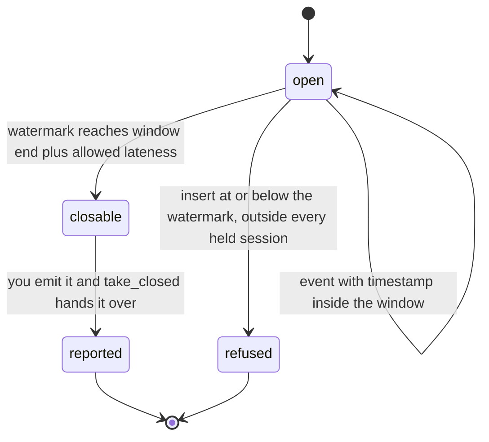
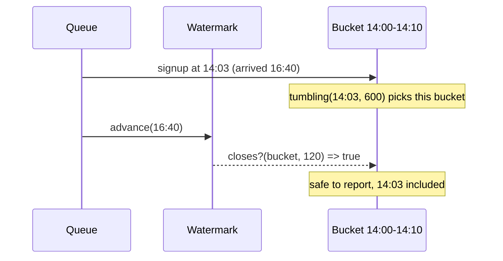

# WindowMachines

> Bucket events by when they happened, not by when they finally showed up. 🔭

Event-time windows for Ruby. Give it a timestamp and it tells you which tumbling or sliding bucket the event belongs in. Give it a `Watermark` and it tells you when a bucket is safe to close. Give it a `Sessions` tracker and it groups bursts of activity, merging two bursts into one when a late arrival turns out to bridge the gap.

## Quick Start

```bash
gem 'window_machines'
```

```ruby
# Every event lands in a ten-minute bucket, keyed by its own timestamp.
bucket = WindowMachines.tumbling(event.at, 600)   # => a Window with start and end

# Nothing gets reported until the watermark says the bucket is done.
watermark = WindowMachines::Watermark.new
watermark.advance(latest_timestamp_seen)          # => :advanced
watermark.closes?(bucket, 120)                    # => true once the bucket is two minutes behind

# Activity bursts, split by five minutes of silence, merged if something fills the gap.
sessions = WindowMachines::Sessions.new(300)
case sessions.insert(event.at)
in WindowMachines::Opened[session]   then start_aggregate(session)
in WindowMachines::Extended[session] then merge_aggregates_inside(session)
in WindowMachines::Covered[session]  then add_to_aggregate(session)
in :late | :full | :overflow => refused then park(event, refused)
end
sessions.advance_watermark(latest_timestamp_seen) # => :advanced
sessions.take_closed                              # => the oldest finished Session, or nil
```

Timestamps, widths, gaps and lateness are Integers in one event-time unit you pick. Seconds, milliseconds, ticks. They are event time, not a monotonic clock, so they are not nanoseconds unless you say so. The gem never looks at a clock.

## A Message to the Resistance

So you built the signups-per-ten-minutes chart. You bucket each event by `Time.now` as it comes off the queue, you flush the bucket when the clock crosses the boundary, product loves it.

Then the mobile app ships an offline queue. A user signs up on a plane at 14:03, the phone syncs at 16:40, and your chart puts the signup in the 16:40 bucket. The 14:00 bucket was flushed two hours ago and will never be corrected. Nobody notices until finance reconciles the month and the numbers don't add up.

The event knew when it happened. Your pipeline threw that away and used arrival time instead, because arrival time is what the clock on the wall gives you for free.

This gem is the other way around. The event's own timestamp decides the bucket. A watermark you advance decides when a bucket has waited long enough for stragglers. Late arrivals land in the right bucket or get refused with an answer that says why, never quietly misfiled.

## Chapter 1: Stardate 2025.186, the AMS Akidau

> **AMS Akidau**, NCC-4219, *Akidau*-class survey vessel.
> The order telemetry arrives is not the order the stars emitted it.

Light from a near star reaches the survey deck in minutes. Light from a far one takes years. The deck doesn't log a supernova under the day the photons hit the sensor. It logs it under the day it happened, and it waits a stated grace period before declaring any day's catalogue final.

Somewhere in the chart room, a cadet files:

```ruby
def bucket_for(event)
  (Time.now.to_i / 600) * 600   # close enough
end
```

"That," says the survey officer, "is how a supernova ends up catalogued two years late."

## The Flight Plan

Each window moves through three states as the watermark catches up with it:



And the signup that flew in from a plane:



With the grace period set to two minutes, a bucket closes once the watermark is two minutes past its end. Any event that still claims to belong in a closed bucket is refused instead of miscounted.

## How Windows Work

### Tumbling

Fixed-size, back-to-back buckets. A timestamp belongs to exactly one.

```ruby
WindowMachines.tumbling(12, 10)   # => #<data WindowMachines::Window start=10, end=20>
WindowMachines.tumbling(19, 10)   # => the same window
WindowMachines.tumbling(20, 10)   # => #<data WindowMachines::Window start=20, end=30>
WindowMachines.tumbling(2**64 - 1, 10)   # => :overflow, that bucket would end past the last timestamp
```

Windows are half-open. The start is inside, the end is not, so 20 begins the next bucket. A `Window` is a frozen `Data` with `start` and `end`.

### Sliding

Overlapping buckets of one width, started every `slide`. A timestamp can sit in several at once. You get them newest first.

```ruby
WindowMachines.sliding(12, 10, 5)   # => [Window(10, 20), Window(5, 15)]
WindowMachines.sliding(7, 10, 5)    # => [Window(5, 15), Window(0, 10)]
```

A slide wider than the width leaves holes. A timestamp that falls into a hole gets an empty list, not a guess:

```ruby
WindowMachines.sliding(12, 1, 5)    # => []
```

One call answers at most `WindowMachines::CAPACITY` (32) windows. A width-to-slide ratio that needs more is `:undersized`: you get no list rather than a truncated one.

```ruby
WindowMachines.sliding(100, 33, 1)  # => :undersized
```

### Watermarks

A watermark is your claim that nothing older than this will still turn up. You advance it. It never moves backwards.

```ruby
watermark = WindowMachines::Watermark.new
watermark.value           # => nil, nothing seen yet
watermark.advance(22)     # => :advanced
watermark.advance(22)     # => :repeated, already there, nothing changed
watermark.advance(9)      # => :regressed, refused, nothing changed
watermark.value           # => 22
```

Repeating the value it already holds is not a refusal: the claim you are making already stands. Only a value behind it is refused. `WindowMachines::Watermark.at(22)` builds one that already stands at 22, for progress you saved or read from somewhere else.

`closes?` answers whether a window has waited long enough. It takes the window plus how much lateness you're willing to absorb:

```ruby
bucket = WindowMachines::Window.new(10, 20)
watermark.closes?(bucket, 2)                              # => true, 20 + 2 is not past 22
watermark.closes?(bucket, 3)                              # => false, give it one more tick
watermark.closes?(WindowMachines::Window.new(20, 30), 0)  # => false, still open
```

`closes?` is a question, so it never refuses. It reads only the window's `end`; an end plus lateness past `2**64-1` is a point no watermark can reach, and the answer is `false`.

### Sessions

Sessions have no fixed size. A session is a run of events where no two neighbours are more than `gap` apart. Insert says what the event did and hands back the `Session` (`first`, `last`) it ended up in.

```ruby
sessions = WindowMachines::Sessions.new(5)
sessions.insert(10)   # => Opened[Session(10, 10)], a new session
sessions.insert(15)   # => Extended[Session(10, 15)], five apart, still one session
sessions.insert(30)   # => Opened[Session(30, 30)], too far, a second session
sessions.insert(21)   # => Opened[Session(21, 21)], nine from 30, a third
sessions.insert(12)   # => Covered[Session(10, 15)], already inside, nothing changed
```

Then the late one shows up:

```ruby
sessions.insert(26)   # => Extended[Session(21, 30)], bridges the gap and merges two sessions into one
```

`Opened`, `Extended` and `Covered` are small `Data` values with one reader, `session`. On `Extended`, merge every aggregate you keep whose old session lies inside the new boundaries. `Covered` means the boundaries already include that timestamp. The tracker keeps boundaries, not events, so it cannot tell a replayed event from a second event at the same time; if that matters, dedupe by your own event id.

A session is finished once the watermark is a full `gap` past its last event. `take_closed` hands you the oldest finished session and forgets it. Call it until it returns `nil`.

```ruby
sessions.advance_watermark(25)
sessions.take_closed      # => Session(10, 15), 15 + 5 is behind 25
sessions.take_closed      # => nil, Session(21, 30) is still open
```

An event at or below the watermark that would have to open or move a session is late. It is refused and the sessions are untouched. One that a held session already covers moves nothing, so it is still `Covered`, right up until you drain that session:

```ruby
sessions.insert(24)       # => Covered[Session(21, 30)], below the watermark but already inside
sessions.insert(20)       # => :late, it would have to stretch a session backwards

sessions.advance_watermark(40)
sessions.take_closed      # => Session(21, 30)
sessions.insert(24)       # => :late, that session is gone and nothing remembers it
```

## The Rules of the Survey

- **Everything is an Integer** in `0..2**64-1`, in the event-time unit you chose. Floats, strings, `nil` and anything else raise `TypeError`. Negative or oversized values raise `RangeError`.
- **Zero widths, sizes, slides, and gaps raise `RangeError`.** A bucket of size zero holds nothing, and the core cannot even be asked.
- **Refusals don't raise.** `:overflow`, `:undersized`, `:regressed`, `:late` and `:full` are answers, each with its own symbol and no catch-all, and a refused call changes nothing. Only malformed input raises.
- **Every answer, by method.**

  | Method | Honoured | Refused | Records the clock |
  | --- | --- | --- | --- |
  | `WindowMachines.tumbling(timestamp, width)` | a `Window` | `:overflow` | no clock, nothing recorded |
  | `WindowMachines.sliding(timestamp, size, slide)` | an Array of `Window`, newest first, `[]` in a hole | `:overflow`, `:undersized` | no clock, nothing recorded |
  | `Window.new(start, end)`, `Session.new(first, last)` | the value | never refuses; an invalid value raises `RangeError` | no clock, nothing recorded |
  | `Session#covers?(timestamp)` | `true` or `false` | never refuses | no clock, nothing recorded |
  | `Watermark#advance(value)` | `:advanced`, or `:repeated` when it already held `value` | `:regressed` | no clock; `:advanced` records the watermark, `:repeated` nothing |
  | `Watermark#closes?(window, allowed_lateness)` | `true` or `false` | never refuses | no clock, nothing recorded |
  | `Sessions#insert(timestamp)` | `Opened`, `Extended`, or `Covered` when a held session already covers it | `:late`, `:overflow`, `:full` | no clock, nothing recorded |
  | `Sessions#advance_watermark(value)` | `:advanced`, or `:repeated` when it already held `value` | `:regressed` | no clock; `:advanced` records the watermark, `:repeated` nothing |
  | `Sessions#take_closed` | a `Session`, `nil` when none is closed | never refuses | no clock, nothing recorded |
- **Repeats are honoured when they can be proven.** A watermark repeated at its own value is `:repeated`. A timestamp inside a held session is `Covered`, even below the watermark. Once `take_closed` drained the session there is no history left to prove it with, and the same timestamp is `:late`.
- **`:overflow` means past the end of event time.** A window whose end, or a session whose `last + gap`, would exceed `2**64-1` is refused.
- **Sliding answers at most 32 windows** (`WindowMachines::CAPACITY`). More is `:undersized`, never a truncated list.
- **Sessions hold at most 32 sessions at once**, closed-but-undrained ones included. A 33rd that joins none of them is `:full` and nothing is dropped to make room. Advance the watermark and drain first.
- **Values mirror the core, and are valid or do not exist.** `Window(start, end)`, `Session(first, last)`, `Opened`/`Extended`/`Covered(session)` are frozen `Data`, checked by the core when built, by hand or by the gem, `with` included. `Window.new(20, 10)` and `Window.new(10, 10)` raise `RangeError` (a window holds at least one timestamp); `Session.new(5, 3)` raises `RangeError`; a non-Integer raises `TypeError`, and so does an `Opened`/`Extended`/`Covered` holding anything but a `Session`. `closes?` takes a `Window`; loose Integers or an Array in its place raise `TypeError`. Every value class is sealed: `allocate` is gone and subclassing raises `TypeError`. Sealing stops accidents, not reflection (a named `class X < Session` still binds its constant, `Data#initialize` can be bound directly, `Marshal.load` skips `initialize`), so the native side is the authority: `closes?`, `covers?` and the `Opened`/`Extended`/`Covered` constructors accept only an instance of exactly `Window` or `Session` (`TypeError` otherwise), read its members without calling any method, and check them through the core again (`RangeError` for an invalid one). The classes are resolved once when the gem loads; swapping a constant later changes nothing the gem builds or accepts.
- **A call that raises changed nothing.** `insert` and `take_closed` build their answer before the tracker keeps the change, so if building it raises the event was not inserted and the closed session is still there to take. If building it changed the tracker (a redefined `Opened.new` or `Session.new` calling back in), the outer call raises `RuntimeError`, is not applied, and that inner change stands. If building it froze the tracker, the call raises `FrozenError` and is not applied.
- **No clock is recorded.** Everything here is event time you pass in; nothing reads or records a monotonic clock. The only progress kept is the watermark, which `advance`/`advance_watermark` record on `:advanced` and leave alone on `:repeated` or `:regressed`.
- **Nothing here issues ids or survives a restart by itself.** There are no handles and no scopes. To resume, rebuild a watermark with `Watermark.at(saved_value)`; sessions are rebuilt by re-inserting.
- **Frozen means frozen.** `freeze` a watermark or a sessions tracker and every mutating call (`advance`, `insert`, `advance_watermark`, `take_closed`) raises `FrozenError`, repeats included.

## What You Think You're Doing vs Reality

### You Think: "I'll just add a small delay before flushing. Late events are rare."
### Reality: Late is a distribution, not an edge case.

Mobile sync, retried webhooks, a consumer that fell behind for an hour. A fixed delay picks one point on that curve and misfiles everything past it. A watermark you advance from the data itself moves with the curve, and `closes?` with explicit lateness makes the trade-off a number you chose, not one you guessed.

## What's Yours

The gem decides boundaries. It never stores a payload. Keep your own counts or rows per `Window` or `Session` (both are `Data`, so they work as Hash keys), add to them when an event is bucketed, and emit them when `closes?` says so or `take_closed` returns a session. Advancing the watermark is also your call. Drive it from the timestamps you've actually seen, with whatever lag your sources deserve.

## License

MIT License. See [LICENSE.txt](LICENSE.txt) for details.

**Remember: The signup happened at 14:03. The phone only admitted it at 16:40.**
