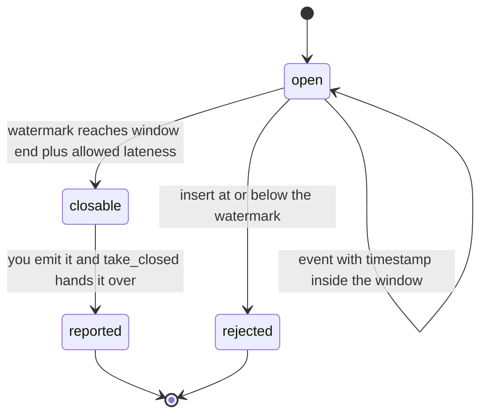
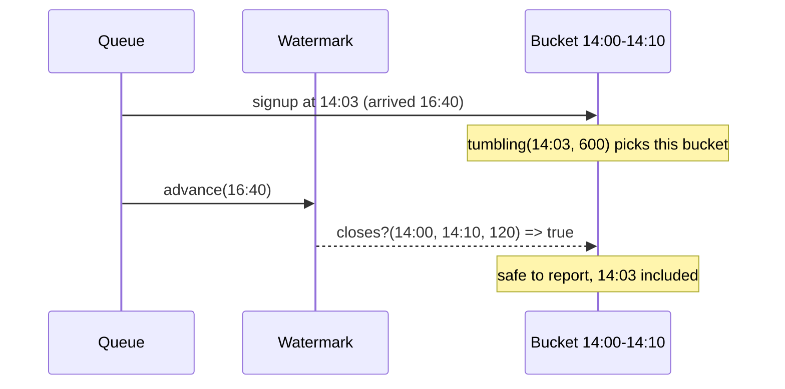

# WindowMachines

> Bucket events by when they happened, not by when they finally showed up. 🔭

Event-time windows for Ruby. Give it a timestamp and it tells you which tumbling or sliding bucket the event belongs in. Give it a `Watermark` and it tells you when a bucket is safe to close. Give it a `Sessions` tracker and it groups bursts of activity, merging two bursts into one when a late arrival turns out to bridge the gap.

## Quick Start

```bash
gem 'window_machines'
```

```ruby
# Every event lands in a ten-minute bucket, keyed by its own timestamp.
WindowMachines.tumbling(event.at, 600)      # => [start, end] of its bucket

# Nothing gets reported until the watermark says the bucket is done.
watermark = WindowMachines::Watermark.new
watermark.advance(latest_timestamp_seen)
watermark.closes?(start, finish, 120)       # => true once start..finish is two minutes behind

# Activity bursts, split by five minutes of silence, merged if something fills the gap.
sessions = WindowMachines::Sessions.new(300)
sessions.insert(event.at)                   # => [first, last] of the session it joined
sessions.advance_watermark(latest_timestamp_seen)
sessions.take_closed                        # => the oldest finished session, or nil
```

Timestamps are Integers in whatever unit you pick. Seconds, milliseconds, ticks. The gem never looks at a clock.

## A Message to the Resistance

So you built the signups-per-ten-minutes chart. You bucket each event by `Time.now` as it comes off the queue, you flush the bucket when the clock crosses the boundary, product loves it.

Then the mobile app ships an offline queue. A user signs up on a plane at 14:03, the phone syncs at 16:40, and your chart puts the signup in the 16:40 bucket. The 14:00 bucket was flushed two hours ago and will never be corrected. Nobody notices until finance reconciles the month and the numbers don't add up.

The event knew when it happened. Your pipeline threw that away and used arrival time instead, because arrival time is what the clock on the wall gives you for free.

This gem is the other way around. The event's own timestamp decides the bucket. A watermark you advance decides when a bucket has waited long enough for stragglers. Late arrivals land in the right bucket or get rejected loudly, never quietly misfiled.

## Chapter 1: Stardate 2025.186, the AMS Akidau

> **AMS Akidau**, NCC-4219, *Akidau*-class survey vessel.
> The order telemetry arrives is not the order the stars emitted it.

Light from a near star reaches the survey deck in minutes. Light from a far one takes years. The deck doesn't log a supernova under the day the photons hit the sensor. It logs it under the day it happened, and it waits a stated grace period before declaring any day's catalogue final.

Somewhere in the chart room, a cadet files:

```ruby
def bucket_for(event)
  (Time.now.to_i / 600) * 600   # close enough
end
```

"That," says the survey officer, "is how a supernova ends up catalogued two years late."

## The Flight Plan

Each window moves through three states as the watermark catches up with it:



And the signup that flew in from a plane:



With the grace period set to two minutes, a bucket closes once the watermark is two minutes past its end. Any event that still claims to belong in a closed bucket is refused instead of miscounted.

## How Windows Work

### Tumbling

Fixed-size, back-to-back buckets. A timestamp belongs to exactly one.

```ruby
WindowMachines.tumbling(12, 10)   # => [10, 20]
WindowMachines.tumbling(19, 10)   # => [10, 20]
WindowMachines.tumbling(20, 10)   # => [20, 30]
```

Windows are half-open. The start is inside, the end is not, so 20 begins the next bucket.

### Sliding

Overlapping buckets of one width, started every `slide`. A timestamp can sit in several at once. You get them newest first.

```ruby
WindowMachines.sliding(12, 10, 5)   # => [[10, 20], [5, 15]]
WindowMachines.sliding(7, 10, 5)    # => [[5, 15], [0, 10]]
```

A slide wider than the width leaves holes. A timestamp that falls into a hole gets an empty list, not a guess:

```ruby
WindowMachines.sliding(12, 1, 5)    # => []
```

### Watermarks

A watermark is your claim that nothing older than this will still turn up. You advance it. It never moves backwards.

```ruby
watermark = WindowMachines::Watermark.new
watermark.value           # => nil, nothing seen yet
watermark.advance(22)     # => true
watermark.advance(9)      # => false, ignored
watermark.value           # => 22
```

`closes?` answers whether a window has waited long enough. It takes the window plus how much lateness you're willing to absorb:

```ruby
watermark.closes?(10, 20, 2)   # => true, 20 + 2 is not past 22
watermark.closes?(10, 20, 3)   # => false, give it one more tick
watermark.closes?(20, 30, 0)   # => false, still open
```

### Sessions

Sessions have no fixed size. A session is a run of events where no two neighbours are more than `gap` apart. Insert returns the span of whichever session the event ended up in.

```ruby
sessions = WindowMachines::Sessions.new(5)
sessions.insert(10)   # => [10, 10], a new session
sessions.insert(15)   # => [10, 15], five apart, still one session
sessions.insert(30)   # => [30, 30], too far, a second session
sessions.insert(21)   # => [21, 21], nine from 30, a third
```

Then the late one shows up:

```ruby
sessions.insert(26)   # => [21, 30], bridges the gap and merges two sessions into one
```

A session is finished once the watermark is a full `gap` past its last event. `take_closed` hands you the oldest finished session and forgets it. Call it until it returns `nil`.

```ruby
sessions.advance_watermark(25)
sessions.take_closed      # => [10, 15], 15 + 5 is behind 25
sessions.take_closed      # => nil, [21, 30] is still open

sessions.advance_watermark(40)
sessions.take_closed      # => [21, 30]
```

Anything at or below the watermark is late by definition and raises, leaving the sessions untouched:

```ruby
sessions.insert(40)   # => raises ArgumentError
```

## The Rules of the Survey

- **Everything is an Integer** in `0..2**64-1`. Floats, strings, and anything else raise `TypeError`. Negative or oversized values raise `RangeError`.
- **Zero widths, slides, and gaps are rejected** with `ArgumentError`. A bucket of size zero holds nothing.
- **Sliding is capped at 32 windows per timestamp.** A width-to-slide ratio that would produce more raises `RangeError` rather than truncating the list.
- **Sessions hold at most 32 open sessions at once.** A 33rd raises `RangeError` and nothing is dropped to make room. Close some first.
- **Late inserts raise.** An event at or below the sessions watermark is refused, not silently folded into something.
- **Frozen means frozen.** `freeze` a watermark or a sessions tracker and every mutation raises `FrozenError`.

## What You Think You're Doing vs Reality

### You Think: "I'll just add a small delay before flushing. Late events are rare."
### Reality: Late is a distribution, not an edge case.

Mobile sync, retried webhooks, a consumer that fell behind for an hour. A fixed delay picks one point on that curve and misfiles everything past it. A watermark you advance from the data itself moves with the curve, and `closes?` with explicit lateness makes the trade-off a number you chose, not one you guessed.

## What's Yours

The gem decides boundaries. It never stores a payload. Keep your own counts or rows per `[start, end]` pair, add to them when an event is bucketed, and emit them when `closes?` says so or `take_closed` returns a span. Advancing the watermark is also your call. Drive it from the timestamps you've actually seen, with whatever lag your sources deserve.

## License

MIT License. See [LICENSE.txt](LICENSE.txt) for details.

**Remember: The signup happened at 14:03. The phone only admitted it at 16:40.**
